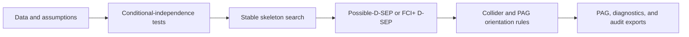

# fci-engine: Fast Causal Inference for Auditable PAG Learning

`fci-engine` is an auditable Python implementation of Fast Causal Inference
(FCI) and sparse FCI+ for learning Partial Ancestral Graphs (PAGs) when latent
confounding or selection may be present. The project combines a reusable typed
package, exact-oracle and finite-sample validation, reference-software
comparisons, and a Tennessee STAR case study.

The submitted [Final Report](deliverables/yq225-final-report.pdf) presents the
research question, implementation, validation evidence, STAR results, and
interpretation limits. Its editable source is
[also committed](deliverables/yq225-final-report.tex).

For reviewers, the project can be summarized as follows:

- **Problem:** recover defensible causal-structure information from
  observational data when latent confounders or selection effects may exist.
- **Output:** a Partial Ancestral Graph rather than an overconfident single DAG.
- **Research contribution:** a typed, auditable implementation of standard FCI
  and the sparse hierarchical D-SEP stage of FCI+ Algorithm 2, with separate
  paper-aligned and finite-sample profiles.
- **Reliability contribution:** stable skeleton discovery, accuracy-first
  separating-set selection, conservative orientation, variable-order audits,
  bootstrap stability analysis, and explicit decision traces.
- **Evaluation:** published oracle graphs, seeded latent-SEM experiments,
  matched reference-software comparisons, scaling tests, and a Tennessee STAR
  case study.



## Project Overview and Core Contributions

| Component | Purpose |
| --- | --- |
| `fci(...)` | Standard FCI with paper-aligned and practical profiles |
| `fci_plus(...)` | Claassen-style bounded hierarchical D-SEP search |
| `stable_fci(...)`, `stable_fci_plus(...)` | Bootstrap stability selection |
| `FCIResult` | PAG, separating sets, CI traces, diagnostics, and exports |
| Exact MAG oracle | Separates graph-search correctness from sampling error |
| Reference runners | Differential comparison with causal-learn and R `pcalg` |
| Tennessee STAR workflow | Randomized-arm summaries and structural sensitivity audits |

Key design choices:

- explicit tail, arrowhead, circle, and absent endpoint semantics;
- separate source-faithful and finite-sample practical configurations;
- inspectable CI, separating-set, D-SEP, and orientation decisions;
- Fisher-Z, missing-value Fisher-Z, chi-square, G-square, and kernel CI tests;
- Python 3.9–3.13 support with typed public APIs.

Unlike a black-box graph learner, each result retains its configuration,
separating sets, CI-test history, orientation-rule events, runtime, and FCI+
D-SEP diagnostics. The same evidence can be inspected interactively or
exported as JSON, CSV, and standalone HTML.

## Installation and Optional Dependencies

Create an environment with Python 3.9 or newer, then install the package:

```bash
python -m pip install -e .
```

For development, validation, plotting, and reference comparisons:

```bash
python -m pip install -e ".[dev,reference]"
```

The optional R comparison requires R and CRAN `pcalg`.

## Quick Start: Learning an Auditable PAG

Choose the entry point according to the purpose of the run:

| Entry point | Intended use |
| --- | --- |
| `fci(data)` | Standard FCI with stable finite-sample defaults |
| `fci(data, profile="paper")` | Source-aligned FCI search and orientation schedule |
| `fci_plus(data, profile="practical")` | Bounded conservative FCI+ for applied analysis |
| `FCI(...).fit(data)`, `FCIPlus(...).fit(data)` | Reusable estimator-style workflows |
| `stable_fci(data)`, `stable_fci_plus(data)` | Bootstrap-filtered sensitivity analysis |
| `run_oracle_benchmark(...)` | Regression testing against known graph structures |

```python
import pandas as pd
from fci_engine import fci_plus

data = pd.read_csv("observations.csv")

result = fci_plus(
    data,
    profile="practical",
    max_cond_set_size=3,
)

print(result.summary())
print(result.to_pandas_edges())
print(result.explain_edge("exposure", "outcome").summary())
```

The practical profile uses stable adjacency snapshots, strongest-at-depth
separating sets, a bounded sparse D-SEP search, and conservative finite-sample
orientation. It is a useful starting point, not a universal statistical
optimum. `max_cond_set_size=3` limits computation and the size of candidate
separators; increasing it may find additional separators but also raises the
number of tests and the opportunity for finite-sample error.

Use `profile="paper"` for Algorithm 2 validation and source-level comparison.
It uses one `k` for ordinary conditioning and hierarchical D-SEP, retains the
first minimal separating set, and follows the paper-aligned search schedule. A
supplied degree bound or conditioning depth remains an analysis setting; it is
not evidence that the unknown population graph satisfies that bound.

For repeated use, instantiate `FCI` or `FCIPlus`. For bootstrap-filtered
structure discovery, use `stable_fci` or `stable_fci_plus`. See the
[quickstart](docs/quickstart.md) and [API reference](docs/api.md) for complete
configuration and export examples.

`FCIResult` can write a complete audit bundle:

```python
paths = result.save_artifacts("outputs", stem="study_fci_plus")
print(paths["json"])
print(paths["edges_csv"])
print(paths["report_html"])
print(result.assumption_notes())
```

Use `MissingValueFisherZTest` for continuous data with missing values,
`ChiSquareTest` or `GSquareTest` for discrete data, and `KernelCITest` for
nonlinear continuous relationships. A domain-specific test can implement the
public `CITest` interface and pass through the same API.

## Interpreting Partial Ancestral Graph Output

A learned PAG represents a Markov-equivalence class, not a unique DAG:

| Endpoint | Meaning |
| --- | --- |
| tail `-` | ancestry is invariant at that endpoint |
| arrowhead `>` | the endpoint node is not an ancestor of the other node |
| circle `o` | ancestry remains unresolved |
| bidirected `<->` | compatible with latent confounding, but not proof of it |

An adjacency does not provide an effect magnitude or adjustment set. Sample CI
tests, discretization, missingness, clustering, variable order, and threshold
choice can all change the learned PAG. The package therefore exposes decision
traces and stability diagnostics instead of hiding these dependencies.

## Finite-Sample Accuracy and Reliability Strategy

The implementation addresses several distinct sources of instability:

| Risk | Mitigation |
| --- | --- |
| Order-dependent edge deletion | Stable adjacency snapshots within each conditioning depth |
| Near-threshold independence decisions | Strongest independence evidence at the first successful depth |
| Overconfident collider orientation | Conservative collider and robust orientation options |
| Dense Possible-D-SEP exploration | Ordered edge-state search rather than full simple-path enumeration |
| Weak finite-sample edges | Bootstrap adjacency filtering and stability frequencies |
| Unverifiable graph decisions | CI, separating-set, orientation, and edge-level explanations |

For a substantive result, the intended protocol is to:

1. run the practical FCI+ profile as the primary finite-sample analysis;
2. repeat the analysis under multiple column orders and separate stable
   adjacencies from stable endpoint marks;
3. report bootstrap adjacency frequencies, using a domain-appropriate cluster
   bootstrap when observations are grouped;
4. repeat important fits across alpha, conditioning-depth, and data-coding
   choices;
5. compare standard FCI, paper-aligned FCI+, and independent reference
   software on matched inputs; and
6. reject or downgrade directions that conflict with randomization, temporal
   order, or other stronger design knowledge.

This protocol treats stability as evidence about robustness, not proof that a
remaining PAG is the unique population graph.

## Validation, Benchmarks, and Reproducibility

The committed suite contains 367 tests covering graph semantics, CI tests,
skeleton search, Possible-D-SEP, FCI+ hierarchy construction, orientation
rules, published oracle targets, order invariance, stability profiles, result
exports, software comparison, and the STAR workflow.

```bash
python -m pytest -q
python -m ruff check src tests examples case_studies
python -m ruff format --check src tests examples case_studies
python -m mypy
python -m mypy case_studies/tennessee_star
python -m build
```

Validation evidence includes:

- exact recovery of three pre-specified published-structure targets;
- a 15-run known-truth latent-SEM benchmark;
- matched-input comparisons with causal-learn and R `pcalg::fciPlus`;
- deterministic scaling and cyclic-variable-order audits;
- school-cluster bootstrap and threshold/binning sensitivity for STAR.

The strongest algorithm-fidelity fixture is the D-SEP MAG in FCI+ Figure 4(b).
Exact m-separation supplies the CI answers, isolating graph-search correctness
from sampling error. Both algorithms recover the complete published PAG; FCI+
removes `X-Y` in its hierarchical D-SEP stage with the unique separator
`{U, V, Z}`.

| Reproducible experiment | FCI+ | Standard FCI | Interpretation |
| --- | --- | --- | --- |
| Figure 4(b), exact oracle | Exact PAG; 63 CI queries | Exact PAG; 102 CI queries | 39 fewer queries (about 38%) on this fixture only |
| Seeded latent SEM, `N=5,000` | Extra `X <-> Y`; exact F1 0.923 | Exact PAG; exact F1 1.000 | Sampling error can prevent FCI+ candidate recognition |
| Same SEM, `N=50,000` | Exact PAG; exact F1 1.000 | Exact PAG; exact F1 1.000 | Reproducible integration evidence, not a universal threshold |

The suite also verifies three complete published-structure targets and four
representative variable orders for Figure 4(b). Exact-oracle recovery supports
algorithmic correctness under sound CI answers; it does not promise recovery
from arbitrary finite samples. Scaling audits deliberately report cases where
FCI+ augmentation overhead dominates as well as cases where hierarchical
D-SEP reduces queries, avoiding a universal speed claim.

The extended evidence source, frozen tables, figures, and generators are under
[`reports/`](reports/). Generated benchmark and showcase examples are grouped
under [`examples/`](examples/README.md).

## Applied Evaluation: Tennessee STAR Case Study

The applied workflow uses the Tennessee Student/Teacher Achievement Ratio
randomized class-size experiment. Randomization is treated as stronger design
evidence than a learned PAG; FCI-family output is used to examine achievement,
observation, selection, and structural sensitivity rather than to rediscover
the randomized treatment effect.

STAR-specific data coding, cohort selection, school-cluster bootstrap,
visualization, and interpretation remain outside the reusable package. The
focused sensitivity grid varies alpha, three versus four achievement bins, and
FCI+ `k` in `{2, 3, 4}`. The PAG adjacency analysis uses 100 school-cluster
bootstrap resamples; those frequencies diagnose stability and are not endpoint
validation or treatment-effect confidence intervals.

The visual comparison runs standard FCI, this project's FCI+, and CRAN
`pcalg::fciPlus` on matched inputs. The three implementations agree on the
focused treatment-outcome PAG but not on every attrition or longitudinal
endpoint. Accordingly, the report distinguishes cross-implementation skeleton
evidence from less stable orientation claims.

Reproduce the committed R reference and Python analysis with:

```bash
Rscript case_studies/tennessee_star/pcalg_reference.R
PYTHONPATH=src python -m case_studies.tennessee_star.run_case_study
```

See the [case-study guide](case_studies/tennessee_star/README.md) for data
provenance, panel definitions, generated artifacts, and the interpretation
boundary. The raw committed STAR archive is checksum-verified; processed
analysis panels and machine-readable outputs are retained for auditability.

## Repository Structure and Artifact Locations

```text
src/fci_engine/                 reusable FCI/FCI+ package
case_studies/tennessee_star/    STAR data, analysis, R reference, and outputs
reports/                        extended evidence, figures, data, and generators
examples/                       tutorials, benchmarks, showcases, and snapshots
tests/                          algorithm, integration, artifact, and case-study tests
docs/                           quickstart, API reference, and theory notes
deliverables/                   project plan and submitted final report
logbook/                        chronological development record
title/                          course project metadata
typings/                        local typing support
.github/                        CI and course-deliverable checks
```

## Documentation and Reproduction Guides

- [Quickstart and configuration](docs/quickstart.md)
- [API reference](docs/api.md)
- [Theory and assumptions](docs/theory.md)
- [Examples index](examples/README.md)
- [STAR reproduction guide](case_studies/tennessee_star/README.md)
- [Development logbook](logbook/logbook.md)

## Methodological Scope and Limitations

- Population-level guarantees require Markov, faithfulness, correct CI
  decisions, and the assumptions of the selected algorithm profile.
- FCI+ polynomial query bounds require a suitable sparse degree bound and an
  exact constant-time independence oracle; finite-sample tests do not satisfy
  that oracle idealization.
- Row-wise CI tests are not cluster-robust. STAR school bootstrapping diagnoses
  sensitivity but does not repair the row-wise test.
- Bootstrap adjacency frequencies are stability diagnostics, not posterior
  probabilities.
- No learned PAG in this repository identifies a unique causal graph or an
  effect magnitude by itself.

## Software License and Data Attribution

The software is released under the [MIT License](LICENSE). The Tennessee STAR
data retain their source licence and citation requirements; see the case-study
guide for provenance.
